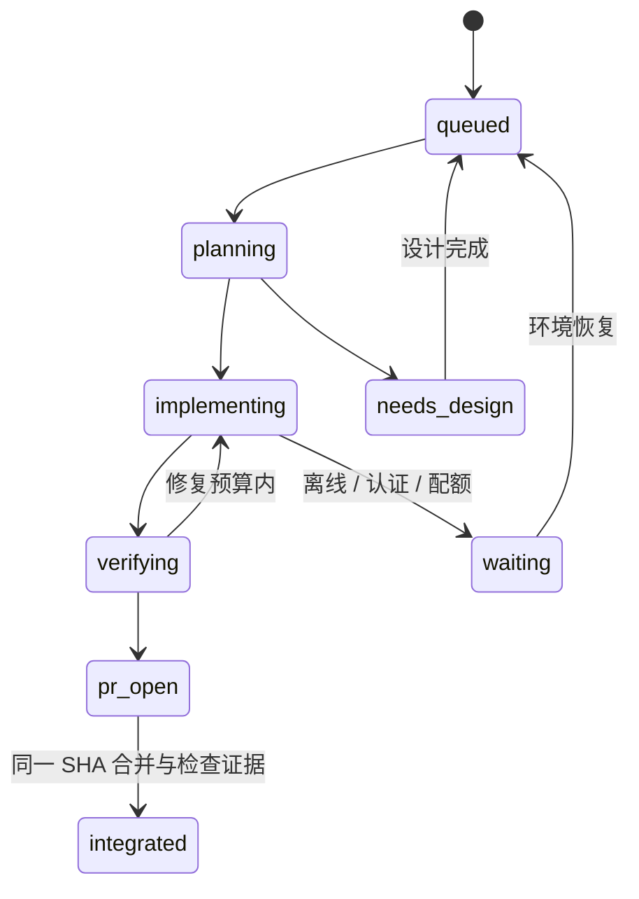

# 共享核心与自动跟进实施记录（2026-10-11）

本记录对应已批准的跨端共享核心和持续交付方案。当前实现的是能力规范、
调度状态机、任务账本、CI 和人工发布入口的第一批基础设施；**整个方案尚未完成，
自动编程、自动开 PR、自动合并、测试环境部署和产物晋级尚未启用**。

代码基线：`300af1e9ca532c9c229155d9fb805ea771552519`。
工作分支：`codex/shared-core-delivery-automation`。
本次没有修改业务数据库、历史迁移、生产配置、仓库可见性或 GitHub 变量。

## 已实现的行为

| 组件                         | 行为                                                                     | 边界                                                |
| ---------------------------- | ------------------------------------------------------------------------ | --------------------------------------------------- |
| `specs/capabilities.json`    | 8 组规范、40 个平台目标，稳定 ID 和 revision                             | 是待核验目标，不表示五端已达标                      |
| `automation/engine.py`       | 去重、规范升级、旧任务 supersede、明确状态迁移、两次修复上限             | 不执行模型，不信任模型提供的通过结论                |
| `automation/ledger.py`       | SQLite 原子日志、单任务/单主机互斥、重启恢复、执行预算预留               | 当前是本地协调器缓存；尚未与 Issue/worker 完成联调  |
| `automation/coordinator.py`  | GitHub Issue 账本创建与更新、重复/中断重跑去重                           | 单协调器；普通 Issue 正文不作为任务命令             |
| `automation/catalog_gate.py` | PR/推送比较规范基线，禁止不增加版本的改动和删除历史能力                  | 新增目录的第一次提交允许建立基线                    |
| `automation/evidence.py`     | 精确 SHA、指定 workflow ID、必需检查全部成功、默认拒绝自动合并           | 调用方必须从 GitHub 读取证据，不能接受 PR 自报 JSON |
| `automation/release.py`      | 手动 main 发布、操作者和重跑者允许名单、当前提交各工作流最后一次运行成功 | 仍对接原监督器，不是最终的不可变产物晋级            |

账本状态：



活动任务也可以进入 `blocked`；新规范版本将旧的未完成任务置为
`superseded`。租约不会因为时钟超时自动转移：必须先确认旧进程已经结束。
否则新旧进程可能同时编辑相同任务或消耗同一账户会话。

执行预算在启动前持久化预留：单次最多 2700 秒，单任务总计最多 7200 秒。
进程崩溃不会退还预留预算，因而采取保守上界；目前不是按实际运行秒数计费。
环境等待不计为代码修复。状态机本身不杀进程，未来 worker 必须实施完整进程树
终止并确认后才能释放租约。

## CI 与生产入口

新增工作流：

- `web-ci.yml`：PR、base/main 推送运行 check、lint、Vitest、build。
- `automation-ci.yml`：Windows/Linux 调度测试、部署监督器测试、能力引用和版本校验。
- `apple-ci.yml`：macOS 上运行现有 `swift test --package-path ios`。
- `client-followup.yml`：main 推送、每天补偿或人工触发，协调 Issue 账本。

保留 `native-core.yml` 的三 OS Rust/WASM 和 Windows 桥接/应用检查。
`deploy.yml` 取消 main push 自动生产发布，只保留 workflow_dispatch；读取部署
密钥之前要求本次 dispatch 的 exact SHA 在以下 main push 检查中通过：Web、
三 OS native、两 OS automation、Swift package。未运行、跳过、失败、旧 SHA
或上一成功 attempt 都不能替代当前证据。

**现有生产监督器仍要求请求 SHA 等于部署分支最新 HEAD，并可能在服务器重新构建。**
因此本阶段不能宣称实现了“测试一次、晋级同一 digest”。也不能把新增 Swift job
当作 iOS 模拟器、Apple C ABI、JSON → SQLite 或完整 macOS UI 验收。
Android 构建、真机/模拟器、混合版本数据库与跨端 E2E 尚未接入统一必需门禁。

GitHub 托管 Runner 保留现有用法；切换私有仓库后必须先确认免费分钟额度与专用
Runner 路由，不能默认开启付费超额用量。没有保护规则强制能力时自动合并保持
关闭，不能用一个布尔配置谎报保护规则已生效。

## 激活条件与配置

本次远端只读检查：仓库 `Jiusi-pys/ebooks` 仍为 public，Runner 数量为 0。
Mac 开发通道尚未确认在线。未设置以下配置：

| 配置                                               | 含义                                            |
| -------------------------------------------------- | ----------------------------------------------- |
| Repository variable `FOLLOWUP_LEDGER_ENABLED=true` | 启用 Issue 协调；初次会排入全部 40 个待核验目标 |
| Repository variable `SHUFANG_RELEASE_ACTORS`       | 非空 JSON 用户名数组；发起人和重跑人都须在其中  |
| Secret `SHUFANG_DEPLOY_TOKEN`                      | 原有生产监督器认证；只在人工发布末步使用        |

Issue 协调器使用仅 contents:read、issues:write 的 GITHUB_TOKEN。它没有
contents:write、pull-requests:write 或生产权限。`FOLLOWUP_LEDGER_ENABLED`
仅控制任务清单，**不启动 Codex**。关闭变量可以停止新增调度，不会删除历史 Issue。

迁移到账号授权的 Codex worker 之前仍须完成：

1. 为生产拉取和发布产物配置独立只读凭据，实测拉取，再将仓库设为 private。
2. Windows/Mac 使用专用系统用户/隔离执行环境，各自独立登录 Codex；不可复制或
   并发共享同一个可刷新的认证文件。不要在公开 PR 的自托管进程中暴露账号。
3. 注册受控 Runner，确认系统依赖、磁盘、网络、构建 SDK 和宿主机互斥；避免
   日常交互用户与 worker 共用含生产密钥、SSH agent 或部署权限的环境。
4. 外部可信编排程序拥有状态和预算，模型进程只改自己的 checkout；独立 verifier
   从进程退出结果、测试产物及 GitHub 读取证据。Issue 自报状态不能授权合并。
5. 发布 GitHub App 专用 PR 身份、独立审核与必需门禁；验证机器人开出的 PR 真正
   触发 CI。现有协调器并未实现这些 PR 操作。

相关账号自动化约束参考 [Codex CI/CD 认证](https://learn.chatgpt.com/docs/auth/ci-cd-auth)
和 [非交互执行](https://learn.chatgpt.com/docs/non-interactive-mode)。本机 CLI 已核对
`codex exec --help`，尚未启动无人值守账号会话。

## 后续实施门槛（未完成）

按原方案继续，不把当前基础设施视为业务迁移完成：

| 阶段  | 尚缺的交付                                                                                              |
| ----- | ------------------------------------------------------------------------------------------------------- |
| P0/P1 | 私有拉取预检、专用 Runner 和账号安装；真实 GitHub workflow 运行；统一 Android/Apple/数据库门禁          |
| P2    | Rust 统一命令接口；Web read-context → mutation-plan → IDB 原子提交；宿主能力拆分；跨语言一致性 fixtures |
| P3    | 完整旧版本库存；iOS JSON → SQLite 的备份、保真导入、校验和切换；失败恢复及混合版本测试                  |
| P4    | Apple XCFramework、Swift 桥接、iOS 全量迁移和 macOS 完整 UI/功能；Mac 实机运行证据                      |
| P5    | 真实 Codex worker、Issue/本地日志协议、独立验证/审核、PR 回路、main→base 同步 PR；三轮故障试运行        |
| P6    | 自动测试包/测试环境；签名和产物来源记录；监督器支持已批准祖先 SHA；不可变 digest 手工晋级               |

共享业务采用模块化单体和端口/适配器，保留原生 UI。同步/迁移/认证/备份/
ABI/测试与策略变更均为高风险；现有策略仅将窄范围 UI 路径列为低风险候选。
所有自动合并还须通过独立审核、当前基线检查和服务端强制保护规则。

迁移仍遵循根 AGENTS.md：先设计版本化迁移，历史仅追加，独立完整归档，
空库/上一版/跳版/重复/失败恢复/数据保留验证。不得把容器回退称为数据库回退。

## 本地验证

```powershell
python -m unittest discover -s automation/tests -p 'test_*.py'
python -m automation validate
python -m automation.catalog_gate
python -m unittest discover -s deploy -p 'test_*.py'
```

本次结果：自动化 31 项、现有部署 15 项通过。能力目录 8 组引用均存在。
app 的 `npm run check`、`npm run lint`、`npm test -- --maxWorkers=4`、
`npm run build` 均成功；Vitest 为 628 passed / 53 skipped，不能据此宣称
被跳过的 MySQL/集成场景通过。构建仍报告已有大 bundle、动态/静态混合导入等警告。

SQLite 测试第一次受 Windows 沙箱临时目录 ACL 限制，扩大本地执行权限后通过；
测试使用临时库与回环 HTTP 服务，没有连接生产数据库。GitHub workflow 尚未
推送运行；Mac/Android GUI 和真实多端迁移未在本次验证。
